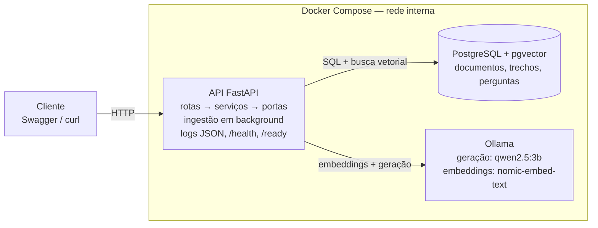

# EduRAG — Spec (SDD)

> Spec-Driven Development · versão 1.0 · 13/10/2026 · autor: Rafael

---

## 1. Visão geral

O EduRAG é uma API que recebe PDFs de documentos educacionais (editais, regulamentos, materiais de curso), indexa o conteúdo e responde perguntas citando a página de onde tirou a resposta. É um projeto de estudo: a aplicação é deliberadamente simples para que o esforço de aprendizado fique na **operação**.

O projeto tem duas camadas:

- **Camada A — aplicação (esta spec, seções 2 a 7).** Pode ser construída com ajuda da IA, tarefa por tarefa.
- **Camada B — operação (seção 8).** Pipeline segura, segredos, observabilidade, LLMOps e Kubernetes. Essa camada você aplica por conta própria, usando a IA para explicar, não para fazer.

**Princípio de design:** a aplicação nasce *pronta para ser operada*. Configuração só por variáveis de ambiente, logs em JSON, endpoints de saúde e nenhum segredo no código. Assim a Camada B encaixa sem refatorar a Camada A.

---

## 2. Requisitos funcionais

Cada requisito só está pronto quando o critério de aceitação passa em teste automatizado.

| ID | Requisito | Critério de aceitação |
| --- | --- | --- |
| RF01 | Enviar um PDF | Aceita só PDF de até 20 MB; responde `202` com o id do documento e status `processando`. Outro tipo → `400`; maior → `413`. |
| RF02 | Ingerir o documento | Extrai o texto por página, divide em trechos (~800 tokens, sobreposição de 100), gera embeddings e grava. Status vira `pronto`; PDF sem texto vira `erro` com o motivo. |
| RF03 | Listar e consultar documentos | Lista com nome, status, nº de páginas e data; detalhe por id; id inexistente → `404`. |
| RF04 | Excluir documento | Remove o documento e todos os seus trechos; responde `204`. |
| RF05 | Fazer uma pergunta | Recebe a pergunta e, opcionalmente, os ids dos documentos; devolve resposta + fontes (documento, página, trecho, score). |
| RF06 | Responder "não encontrei" | Se o melhor trecho ficar abaixo do limiar de similaridade, responde que não encontrou a informação **sem chamar o LLM**. O limiar é conservador (ver "Limitação conhecida"): a maioria das recusas vem do próprio LLM, guiado pelo prompt, e nesse caso a resposta não traz fontes. |
| RF07 | Guardar histórico | Toda pergunta grava pergunta, resposta, fontes, modelo usado e latência em ms; listagem paginada. |
| RF08 | Informar saúde | `/health` responde `200` se o processo está vivo; `/ready` só responde `200` se banco e Ollama respondem. |

---

## 3. Requisitos não funcionais e restrições

O projeto precisa rodar inteiro numa máquina comum, sem GPU e sem custo.

- **Execução local:** tudo sobe com `docker compose up`, em CPU, usando modelos pequenos e quantizados do Ollama.
- **Configuração:** 100% por variáveis de ambiente; o repositório tem só um `.env.example` sem valores reais.
- **Logs:** JSON no stdout, com `request_id` em cada linha e sem o conteúdo dos PDFs.
- **Desacoplamento:** LLM, embeddings e banco ficam atrás de interfaces (portas). Trocar o Ollama por uma API externa não muda o domínio.
- **Testes:** pytest; LLM e embeddings substituídos por *fakes* nos testes unitários; cobertura mínima de 70% em `domain/`.
- **Qualidade de código:** ruff para lint e formatação; type hints em todo o código.
- **Container:** imagem slim, multi-stage, rodando como usuário não-root.
- **Idioma:** respostas sempre em português.

---

## 4. Arquitetura, stack e estrutura de pastas

Toda a aplicação sobe com um `docker compose up`: três serviços numa rede interna.



A API segue arquitetura em camadas com portas e adaptadores: as **rotas** só validam entrada e saída, os **serviços** de domínio têm a regra de negócio e falam com o mundo externo apenas através de **portas** (interfaces). Os **adaptadores** implementam essas portas para Ollama e PostgreSQL.

### Stack

| Componente | Escolha | Por quê |
| --- | --- | --- |
| Linguagem | Python 3.12 | Ecossistema de IA; é o que a vaga espera |
| Gerenciador de pacotes | uv | Rápido, lockfile reproduzível |
| API | FastAPI + Uvicorn | Swagger automático, tipagem com Pydantic |
| Banco | PostgreSQL 16 + pgvector | Você já conhece Postgres; vetores no mesmo banco |
| ORM e migrations | SQLAlchemy 2 + Alembic | Equivalente ao JPA/Flyway do mundo Java |
| LLM | Ollama com `qwen2.5:3b` | Roda em CPU, bom em português |
| Embeddings | Ollama com `nomic-embed-text` (768 dimensões) | Local e gratuito |
| Leitura de PDF | pypdf | Simples, sem dependências nativas |
| Testes | pytest + httpx | Padrão do ecossistema |
| Lint | ruff | Lint e formatação em uma ferramenta |

### Estrutura de pastas

```
edurag/
├── app/
│   ├── main.py                 # cria o app FastAPI e registra as rotas
│   ├── config.py               # lê variáveis de ambiente (pydantic-settings)
│   ├── logging_config.py       # logs JSON com request_id
│   ├── api/
│   │   ├── routes_documents.py
│   │   ├── routes_ask.py
│   │   ├── routes_health.py
│   │   └── schemas.py          # DTOs de entrada e saída
│   ├── domain/
│   │   ├── chunking.py         # divisão do texto em trechos
│   │   ├── ingestion.py        # serviço de ingestão
│   │   ├── qa.py               # serviço de perguntas e respostas
│   │   └── prompts.py          # templates de prompt
│   ├── ports/
│   │   ├── llm.py              # interface LLMPort
│   │   ├── embeddings.py       # interface EmbeddingsPort
│   │   └── repository.py       # interface DocumentRepository
│   ├── adapters/
│   │   ├── ollama_llm.py
│   │   ├── ollama_embeddings.py
│   │   └── pg_repository.py
│   └── db/
│       ├── models.py           # tabelas SQLAlchemy
│       ├── session.py
│       └── migrations/         # Alembic
├── tests/
│   ├── unit/                   # domínio com fakes
│   ├── integration/            # API + Postgres real
│   └── fakes.py                # FakeLLM, FakeEmbeddings
├── scripts/
│   └── pull-models.sh          # baixa os modelos no Ollama
├── docs/
│   └── spec.md                 # este arquivo
├── Dockerfile
├── docker-compose.yml
├── .env.example
├── pyproject.toml
└── README.md
```

### Decisões registradas durante a construção

Mudanças feitas depois da versão 1.0, registradas aqui antes do código (regra 5 da seção 9).

| Data | Decisão | Motivo |
| --- | --- | --- |
| 14/10/2026 | `EmbeddingsPort` ganha `embed_documents` e `embed_query` no lugar de `embed`. O adaptador Ollama aplica prefixos configuráveis (`EMBEDDING_DOCUMENT_PREFIX`, `EMBEDDING_QUERY_PREFIX`; padrão `search_document: ` e `search_query: `, o formato do `nomic-embed-text`). Modelos sem prefixo usam valor vazio. | O `nomic-embed-text` foi treinado com esses prefixos; medido num documento real, o score de uma pergunta genérica subiu de 0,489 para 0,548. Documentos e perguntas têm papéis diferentes, e a porta passa a expressar isso. |
| 14/10/2026 | Nova variável `LLM_NUM_CTX` (padrão 8192), enviada ao Ollama como `options.num_ctx`. | O padrão do Ollama é uma janela pequena (cerca de 4 mil tokens). Com trechos de ~800 palavras e `top_k=5`, o prompt passa disso e o Ollama corta o excesso em silêncio, podendo perder as instruções. |
| 14/10/2026 | `MIN_SCORE` padrão passa de 0,5 para 0,45, a ser recalibrado com mais documentos. | Medido: perguntas válidas sobre um PDF real ficaram entre 0,49 e 0,62 e uma pergunta fora do tema ficou em 0,50 a 0,54; com 0,5 fixo, perguntas genéricas legítimas eram recusadas. O prompt já instrui o LLM a dizer "não encontrei" quando o contexto não responde. Observação posterior (com prefixos, edital de teste): relevantes 0,65 a 0,68 e fora do tema 0,60; o limiar não separa bem, então a recusa depende do prompt. |
| 14/10/2026 | **Limitação conhecida do limiar (alternativa 1 aceita).** O `MIN_SCORE` fica como está e o RF06 passa a disparar só em casos extremos; a recusa de perguntas fora do tema é feita pelo LLM, guiado pelo prompt. Quando o LLM recusa, a resposta volta com `sources` vazio. | Com o `nomic-embed-text` em português, o score de perguntas fora do tema (~0,60) se sobrepõe ao de perguntas relevantes (0,49 a 0,68); nenhum corte fixo separa os dois grupos. Custo assumido: uma chamada ao LLM por recusa e dependência de o modelo obedecer ao prompt. Revisitar com `bge-m3` ou reranker se o uso crescer. |
| 14/10/2026 | `MIN_SCORE` padrão de 0,45 para 0,3, para cumprir a alternativa 1 (limiar só em casos extremos). | Medido no currículo reenviado: "Do que se trata este documento?" teve 0,44 e foi recusada pelo limiar, enquanto "receita de bolo" teve 0,50 a 0,56 e passou. Com 0,45 o limiar recusava perguntas legítimas e deixava passar as fora do tema. |
| 14/10/2026 | Prompt reescrito em regras numeradas: só fatos do contexto; perguntas sobre o assunto do documento são válidas; pedidos de receitas, hipóteses, opiniões, textos criativos, "como ele faria" ou "imagine que" recebem a frase de recusa. A recusa só remove as fontes quando a resposta é exatamente a frase de recusa. | Com o prompt antigo, "Dado que Rafael é desenvolvedor, como ele diria uma receita de bolo?" gerou uma resposta inventada, citando o currículo. O prompt novo recusa esse caso e mantém as respostas legítimas (comparação lado a lado com a mesma busca). |
| 14/10/2026 | Trocar o modelo de embeddings por um multilíngue (ex.: `bge-m3`, 1024 dimensões) fica como alternativa, só se a separação dos scores continuar fraca. | Exigiria migration nova da coluna `embedding` e reindexação de todos os documentos. |

---

## 5. Modelo de dados e contratos da API

### Tabelas

**documents**

| Coluna | Tipo | Observação |
| --- | --- | --- |
| id | uuid | chave primária |
| filename | text | nome original |
| status | enum (`processando`, `pronto`, `erro`) | |
| pages | int | nulo até terminar a ingestão |
| error | text | motivo, quando `erro` |
| created_at | timestamptz | |

**chunks**

| Coluna | Tipo | Observação |
| --- | --- | --- |
| id | uuid | chave primária |
| document_id | uuid | FK para documents, `ON DELETE CASCADE` |
| page | int | página de origem |
| content | text | texto do trecho |
| embedding | vector(768) | índice HNSW com distância cosseno |

**questions**

| Coluna | Tipo | Observação |
| --- | --- | --- |
| id | uuid | chave primária |
| question | text | |
| answer | text | |
| sources | jsonb | lista de fontes devolvidas |
| model | text | modelo usado na geração |
| latency_ms | int | tempo total da requisição |
| created_at | timestamptz | |

### Endpoints

| Método | Rota | Entrada | Saída |
| --- | --- | --- | --- |
| POST | `/documents` | multipart com `file` | `202` `{id, status}` |
| GET | `/documents` | — | `200` lista de documentos |
| GET | `/documents/{id}` | — | `200` documento · `404` |
| DELETE | `/documents/{id}` | — | `204` · `404` |
| POST | `/ask` | `{question, document_ids?, top_k=5}` | `200` `{question_id, answer, sources[]}` |
| GET | `/questions` | `?limit=20&offset=0` | `200` histórico paginado |
| GET | `/health` | — | `200 {status: "ok"}` |
| GET | `/ready` | — | `200` ou `503` com o componente que falhou |

Exemplo de resposta do `/ask`:

```json
{
  "question_id": "8f1c...",
  "answer": "A inscrição vai até 15 de outubro de 2026 [1].",
  "sources": [
    {
      "document_id": "2a9e...",
      "filename": "edital-2026.pdf",
      "page": 3,
      "excerpt": "As inscrições estarão abertas até 15 de outubro...",
      "score": 0.82
    }
  ]
}
```

---

## 6. Fluxos principais

### Ingestão (RF01–RF02)

1. A rota recebe o arquivo e valida tipo e tamanho.
2. Grava o documento com status `processando` e responde `202` na hora.
3. Em background (`BackgroundTasks` do FastAPI), extrai o texto página por página.
4. Divide o texto em trechos, guardando a página de cada um.
5. Gera os embeddings em lote pelo Ollama.
6. Grava os trechos com seus vetores.
7. Atualiza o status para `pronto` ou, se algo falhar, para `erro` com o motivo.

### Pergunta (RF05–RF07)

1. A rota valida a pergunta.
2. Gera o embedding da pergunta.
3. Busca os `top_k` trechos mais próximos por similaridade de cosseno, filtrando pelos documentos informados.
4. Se o melhor score ficar abaixo do limiar (`MIN_SCORE`, configurável), devolve "não encontrei" sem chamar o LLM.
5. Monta o prompt com os trechos numerados e a instrução de responder **só com base no contexto** e citar as fontes pelo número.
6. Chama o LLM.
7. Grava pergunta, resposta, fontes, modelo e latência na tabela `questions`.
8. Devolve a resposta com as fontes.

---

## 7. Plano de tarefas para construir com IA

Cada tarefa cabe em uma conversa com a IA e termina com algo rodando. Faça na ordem.

- [ ] **T1 — Esqueleto.** `pyproject.toml` com uv, app FastAPI, `config.py` lendo env, logs JSON e `/health`. *Pronto quando:* `uvicorn app.main:app` sobe e `/health` responde 200.
- [ ] **T2 — Containers.** Dockerfile multi-stage não-root, `docker-compose.yml` com api, postgres (imagem `pgvector/pgvector`) e ollama, `scripts/pull-models.sh` e `.env.example`. *Pronto quando:* `docker compose up` sobe os três serviços.
- [ ] **T3 — Banco.** Modelos SQLAlchemy e primeira migration Alembic criando a extensão `vector`, as três tabelas e o índice HNSW. *Pronto quando:* a migration roda limpa num banco vazio.
- [ ] **T4 — Portas e adaptadores.** Interfaces `LLMPort`, `EmbeddingsPort` e `DocumentRepository`, adaptadores Ollama e Postgres, fakes para teste e o `/ready` completo. *Pronto quando:* `/ready` responde 200 com tudo de pé e 503 com o Ollama parado.
- [ ] **T5 — Chunking.** Função de divisão em trechos com sobreposição, preservando a página. *Pronto quando:* testes unitários cobrem texto curto, texto longo e página vazia.
- [ ] **T6 — Documentos.** Upload, ingestão em background e rotas de listar, detalhar e excluir (RF01–RF04). *Pronto quando:* um PDF real enviado chega a `pronto` e seus trechos aparecem no banco.
- [ ] **T7 — Perguntas.** Busca vetorial, limiar, prompt e rota `/ask` com fontes (RF05–RF06). *Pronto quando:* uma pergunta sobre o PDF retorna a página certa; uma pergunta fora do tema retorna "não encontrei".
- [ ] **T8 — Histórico.** Gravação em `questions` e rota `/questions` (RF07). *Pronto quando:* cada pergunta feita aparece no histórico com latência.
- [ ] **T9 — Testes de integração.** API com Postgres real (via compose ou testcontainers) e LLM fake. *Pronto quando:* `pytest` passa inteiro e a cobertura de `domain/` é de pelo menos 70%.
- [ ] **T10 — README.** Diagrama, como rodar, variáveis de ambiente e exemplos com curl. *Pronto quando:* alguém consegue rodar o projeto só lendo o README.

**Fim da Camada A.** A partir daqui, o projeto está pronto para a Camada B.

---

## 8. Pontos de extensão (Camada B — você aplica)

Cada fase usa um gancho que a Camada A já deixou pronto. A última coluna mostra qual requisito da vaga do NEES ela treina.

| Fase | O que aplicar | Onde encaixa | Requisito da vaga |
| --- | --- | --- | --- |
| F2 — Pipeline segura | GitHub Actions com ruff, pytest, Semgrep ou Bandit (SAST), Trivy (dependências e imagem), gitleaks (segredos), Dependabot, proteção de branch | `.github/workflows/`; a pipeline falha com vulnerabilidade crítica | CI/CD, Git, segurança de aplicações |
| F3 — Segredos e acesso | SOPS ou Vault, autenticação por API key ou JWT, rate limiting | `config.py` já lê tudo de env; middleware novo em `api/` | Gestão de credenciais e acessos |
| F4 — Observabilidade | Endpoint `/metrics` para Prometheus, painéis e alertas no Grafana, Loki para logs, OpenTelemetry para tracing | Middleware de métricas; os logs JSON e o `request_id` já existem | Observabilidade (logs, métricas, alertas) |
| F5 — LLMOps | Langfuse para rastrear cada pergunta; Ragas com um conjunto de perguntas de referência rodando na CI; defesa contra prompt injection; mascaramento de CPF e e-mail antes de logar; custo em tokens por pergunta | Adaptadores em `adapters/` (ponto único de chamada ao LLM); `domain/qa.py`; tabela `questions` | LLMOps, RAG, monitoramento de modelos, segurança de IA, LGPD, FinOps |
| F6 — Kubernetes | k3s ou kind, manifests, depois Helm; Secrets, probes e limites de recursos; ArgoCD opcional | `/health` e `/ready` viram as probes de liveness e readiness | Kubernetes, containers |
| F7 — Nuvem e IaC (opcional) | Terraform subindo uma VM no nível gratuito e fazendo o deploy | Mesmas imagens publicadas na F2 | Infraestrutura cloud |

Regra de ouro para a Camada B: escreva você mesmo. Peça à IA para explicar conceitos, revisar o que você fez e diagnosticar erros, mas não para gerar a fase inteira. É essa parte que você vai precisar defender numa entrevista.

---

## 9. Fora de escopo e como usar esta spec

### Fora de escopo (por enquanto)

- Interface web (o Swagger do FastAPI basta).
- Autenticação e multiusuário (entram na F3).
- OCR de PDFs escaneados.
- Fila de mensagens (Celery, RQ); o `BackgroundTasks` resolve para o estudo.
- Respostas em streaming.
- Fine-tuning de modelo.

### Como usar com a IA (fluxo SDD)

1. Guarde este arquivo em `docs/spec.md` no repositório; ele é a fonte da verdade.
2. Para cada tarefa da seção 7, abra uma conversa nova e envie as seções 1 a 6 mais a tarefa atual.
3. Peça os arquivos completos com comentários explicando cada parte, e não trechos soltos.
4. Rode, teste e entenda o código antes de fazer o commit; um commit por tarefa.
5. Se uma decisão mudar durante o desenvolvimento (outro modelo, outra biblioteca), atualize a spec **antes** do código.

Modelo de prompt para cada tarefa:

```
Contexto: estou construindo o EduRAG seguindo a spec abaixo.
[cole as seções 1 a 6]

Tarefa atual: [cole a tarefa, ex.: T5 — Chunking]

Entregue os arquivos completos, com comentários explicando cada parte,
e os testes que provam o critério "Pronto quando". Não implemente nada
de tarefas futuras.
```