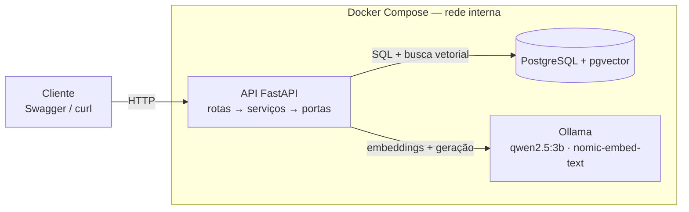

# EduRAG

API que recebe PDFs de documentos educacionais (editais, regulamentos, materiais de curso), indexa o conteúdo e responde perguntas **citando a página** de onde tirou a resposta. Tudo roda localmente, em CPU, com Ollama e PostgreSQL + pgvector.

A especificação completa está em [docs/spec.md](docs/spec.md).

## Arquitetura



- `app/api`: rotas, só validam entrada e saída.
- `app/domain`: regra de negócio (chunking, ingestão, perguntas), fala com o exterior só por portas.
- `app/ports`: interfaces `LLMPort`, `EmbeddingsPort`, `DocumentRepository`.
- `app/adapters`: implementações para Ollama e PostgreSQL.

## Como rodar

Pré-requisitos: Docker com Compose.

```bash
cp .env.example .env          # defina POSTGRES_PASSWORD
docker compose up -d --build  # sobe api, postgres e ollama
./scripts/pull-models.sh      # baixa os modelos (uma vez; alguns GB)
```

Swagger em <http://localhost:8000/docs>. Confira a saúde:

```bash
curl localhost:8000/health   # {"status":"ok"}
curl localhost:8000/ready    # 200 se banco e Ollama respondem; 503 com o componente que falhou
```

## Exemplos

```bash
# 1. enviar um PDF (responde 202 com o id; a ingestão roda em background)
curl -F "file=@edital-2026.pdf" localhost:8000/documents

# 2. acompanhar até status "pronto"
curl localhost:8000/documents/<id>

# 3. perguntar (document_ids e top_k são opcionais)
curl -X POST localhost:8000/ask -H 'content-type: application/json' \
  -d '{"question": "Até quando vão as inscrições?", "top_k": 5}'

# 4. histórico paginado
curl 'localhost:8000/questions?limit=20&offset=0'

# 5. excluir o documento e seus trechos
curl -X DELETE localhost:8000/documents/<id>
```

Se a melhor similaridade ficar abaixo de `MIN_SCORE`, a API responde que não encontrou a informação **sem chamar o LLM**.

## Variáveis de ambiente

| Variável | Padrão | Descrição |
| --- | --- | --- |
| `POSTGRES_USER`, `POSTGRES_PASSWORD`, `POSTGRES_DB` | — | credenciais do banco (compose) |
| `DATABASE_URL` | local | URL SQLAlchemy; o compose a monta sozinho |
| `OLLAMA_BASE_URL` | `http://localhost:11434` | endereço do Ollama |
| `LLM_MODEL` | `qwen2.5:3b` | modelo de geração |
| `EMBEDDING_MODEL` | `nomic-embed-text` | modelo de embeddings (768 dimensões) |
| `MIN_SCORE` | `0.5` | limiar de similaridade para chamar o LLM |
| `MAX_UPLOAD_MB` | `20` | tamanho máximo do PDF |
| `CHUNK_SIZE` / `CHUNK_OVERLAP` | `800` / `100` | tamanho e sobreposição dos trechos (palavras) |
| `LOG_LEVEL` | `INFO` | nível dos logs JSON |

## Desenvolvimento

```bash
uv sync                    # instala dependências (gera uv.lock)
uv run ruff check . && uv run ruff format --check .
uv run pytest              # unitários + API com repositório em memória
```

Para rodar também os testes contra um PostgreSQL real (o `postgres` do compose basta):

```bash
docker compose up -d postgres
TEST_DATABASE_URL=postgresql+psycopg://edurag:<senha>@localhost:5432/edurag \
  uv run pytest --cov=app/domain
```

Os testes de integração truncam as tabelas do banco indicado: aponte para um banco de teste.
