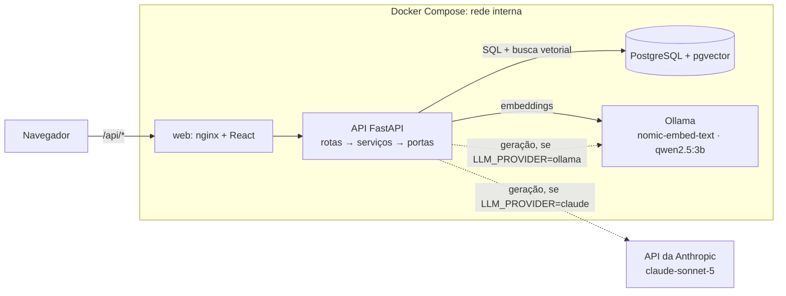

# EduRAG

API que recebe PDFs de documentos educacionais (editais, regulamentos, materiais de curso), indexa o conteúdo e responde perguntas **citando a página** de onde tirou a resposta. Os embeddings rodam localmente no Ollama, com PostgreSQL + pgvector. As respostas vêm do Ollama (local, em CPU) ou do **Claude Sonnet 5** (API da Anthropic), escolhido por variável de ambiente.

A especificação completa está em [docs/spec.md](docs/spec.md), e o plano da pipeline e do deploy em [docs/pipeline-plano.md](docs/pipeline-plano.md).

## Arquitetura



- `app/api`: rotas, só validam entrada e saída.
- `app/domain`: regra de negócio (chunking, ingestão, perguntas), fala com o exterior só por portas.
- `app/ports`: interfaces `LLMPort`, `EmbeddingsPort`, `DocumentRepository`.
- `app/adapters`: implementações para Ollama, Claude e PostgreSQL.

## Como rodar

Pré-requisitos: Docker com Compose.

```bash
cp .env.example .env          # defina POSTGRES_PASSWORD (e, para o Claude, as variáveis abaixo)
docker compose up -d --build  # sobe web, api, postgres e ollama
./scripts/pull-models.sh      # baixa os modelos (uma vez; alguns GB)
```

Interface web em <http://localhost:8080> e Swagger em <http://localhost:8000/docs>. Confira a saúde:

```bash
curl localhost:8000/health   # {"status":"ok"}
curl localhost:8000/ready    # 200 se banco, embeddings e LLM respondem; 503 com o que falhou
curl localhost:8000/llm      # {"provider": "claude", "model": "claude-sonnet-5", "effort": "medium"}
```

### Usar o Claude no lugar do Ollama

No `.env`:

```env
LLM_PROVIDER=claude
LLM_MODEL=claude-sonnet-5
ANTHROPIC_API_KEY=sk-ant-...
LLM_EFFORT=medium
```

Depois, `docker compose up -d api`. A interface mostra o modelo e o esforço logo abaixo da caixa de pergunta.

- **Só o `claude-sonnet-5` é aceito.** Com outro modelo, ou sem a chave, a API não sobe. O modelo é definido no servidor, e a requisição não tem campo para trocá-lo.
- O `.env` está no `.gitignore` e no `.dockerignore`. A chave nunca vai para o repositório nem para o front.
- Use uma chave de um workspace com teto de gastos. Se o teto estourar, a API responde `502`, sem ficar repetindo a chamada.

## Exemplos

```bash
# 1. enviar um PDF (responde 202 com o id; a ingestão roda em background)
curl -F "file=@edital-2026.pdf" localhost:8000/documents

# 2. acompanhar até status "pronto"
curl localhost:8000/documents/<id>

# 3. perguntar (document_ids e top_k são opcionais; top_k de 1 a 10)
curl -X POST localhost:8000/ask -H 'content-type: application/json' \
  -d '{"question": "Até quando vão as inscrições?", "top_k": 5}'

# 4. histórico paginado
curl 'localhost:8000/questions?limit=20&offset=0'

# 5. excluir o documento e seus trechos
curl -X DELETE localhost:8000/documents/<id>
```

Se a melhor similaridade ficar abaixo de `MIN_SCORE`, a API responde que não encontrou a informação **sem chamar o LLM**.

## Variáveis de ambiente

| Variável | Padrão | Descrição |
| --- | --- | --- |
| `POSTGRES_USER`, `POSTGRES_PASSWORD`, `POSTGRES_DB` | — | credenciais do banco (compose) |
| `DATABASE_URL` | **obrigatória** | URL SQLAlchemy; o compose monta sozinho. Sem ela, a API não sobe |
| `OLLAMA_BASE_URL` | `http://localhost:11434` | endereço do Ollama |
| `LLM_PROVIDER` | `ollama` | quem gera as respostas: `ollama` ou `claude` |
| `LLM_MODEL` | `qwen2.5:3b` | modelo de geração; com `claude`, só `claude-sonnet-5` |
| `ANTHROPIC_API_KEY` | — | chave da Anthropic; obrigatória com `claude` |
| `LLM_EFFORT` | `medium` | esforço do Claude: `low`, `medium`, `high`, `xhigh` ou `max` |
| `LLM_MAX_TOKENS` | `1024` | teto de tokens de saída por resposta do Claude |
| `EMBEDDING_MODEL` | `nomic-embed-text` | modelo de embeddings (768 dimensões) |
| `MIN_SCORE` | `0.3` | limiar de similaridade para chamar o LLM |
| `EMBEDDING_DOCUMENT_PREFIX` / `EMBEDDING_QUERY_PREFIX` | `search_document: ` / `search_query: ` | prefixos do `nomic-embed-text`; vazios para outros modelos |
| `LLM_NUM_CTX` | `8192` | janela de contexto do Ollama, em tokens |
| `LLM_TIMEOUT_SECONDS` | `300` | tempo máximo de uma geração |
| `MAX_UPLOAD_MB` | `20` | tamanho máximo do PDF |
| `CHUNK_SIZE` / `CHUNK_OVERLAP` | `800` / `100` | tamanho e sobreposição dos trechos (palavras) |
| `LOG_LEVEL` | `INFO` | nível dos logs JSON |

## Desenvolvimento

```bash
uv sync                    # instala dependências
uv run ruff check . && uv run ruff format --check .
uv run pytest              # unitários + API com repositório em memória
```

Os testes nunca chamam a API da Anthropic: o adaptador do Claude é testado com um cliente falso. A `DATABASE_URL` dos testes vem de `tests/conftest.py`, e os testes em memória não conectam nela.

Para rodar também os testes contra um PostgreSQL real (o `postgres` do compose basta):

```bash
docker compose up -d postgres
TEST_DATABASE_URL=postgresql+psycopg://edurag:<senha>@localhost:5432/edurag \
  uv run pytest --cov=app/domain
```

Os testes de integração truncam as tabelas do banco indicado: aponte para um banco de teste.

### Frontend

React + Vite + Tailwind em `frontend/`. Chama a API por `/api/*`: no desenvolvimento, o Vite repassa para `localhost:8000`; no container, o nginx repassa para o serviço `api` (mesma origem, sem CORS).

```bash
cd frontend
npm install
npm run dev     # http://localhost:5173, com a API rodando em localhost:8000
npm run build && npm run lint
```

## Pipeline (DevSecOps)

Todo PR passa pelos portões abaixo, exigidos pela proteção da `main`. Cada portão foi provado com um PR barrado de propósito (ver [docs/pipeline-plano.md](docs/pipeline-plano.md)).

| Portão | Ferramenta |
| --- | --- |
| Qualidade | `ruff`, `pytest` com Postgres, lint e build do front |
| Segredos | gitleaks |
| Código (SAST) | Semgrep |
| Dependências | Trivy (`fs`), `npm audit`, Dependabot com cooldown de 7 dias |
| Imagens | Trivy (falha em CRITICAL) e checagem de usuário não-root |

Na `main`, as imagens são publicadas no GHCR com a tag do SHA do commit. Próximos passos: infraestrutura na AWS com Terraform, deploy contínuo via SSM e observabilidade com Prometheus + Grafana.
