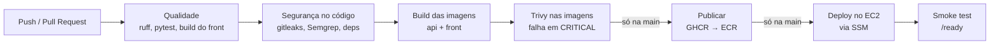

# EduRAG — Plano de implementação da pipeline (F2 → deploy na AWS)

> Atualizado em 12/11/2026. Referências: [spec.md](spec.md) e [progresso.md](progresso.md).
> Regra da Camada B: **você escreve os workflows**; a IA explica e revisa.

## Visão geral

A pipeline é construída em portões: cada etapa só é adicionada depois que a anterior está verde, e **nada chega à AWS sem passar por testes e scans**. O link público só existe depois da F3 (autenticação e rate limit), porque a API passa a gastar créditos reais.

| Bloco | Etapas | Resultado |
| --- | --- | --- |
| A — Integração contínua | 0 a 3 | Todo PR testado; `main` protegida |
| B — Segurança na pipeline | 4 a 7 | Segredos, código, dependências e imagens verificados |
| C — Publicação | 8 | Imagens versionadas num registro |
| D — Pronto para ser público | 9 | Autenticação, rate limit e LLM na nuvem |
| E — Entrega na AWS | 10 a 12 | Deploy automático e link no ar |

---

## Bloco A — Integração contínua

### Etapa 0 — Preparação

- [x] Registrar o frontend na spec: mover "Interface web" de *Fora de escopo* para os requisitos (RF09) e a tarefa (T11).
- [x] Confirmar que nenhum `.env` real está no repositório nem no histórico (`git log --all -- .env`).

*Pronto quando:* a spec descreve o que existe no código.

### Etapa 1 — CI do backend

- [x] Workflow disparado em `push` e `pull_request`.
- [x] Checkout → instalar `uv` (com cache) → `uv sync` → `ruff check` e `ruff format --check`.
- [x] `pytest` com um *service container* `pgvector/pgvector` e `TEST_DATABASE_URL` apontando para ele, rodando as migrations antes.
- [x] Relatório de cobertura como artefato do job.

*Pronto quando:* os 59 testes passam no GitHub, **0 pulados**.
*Para estudar:* sintaxe de workflow (`on`, `jobs`, `steps`), `services`, cache de dependências.

### Etapa 2 — CI do frontend

- [x] Job separado, rodando em paralelo ao do backend.
- [x] `npm ci` (nunca `npm install` na CI) → lint → build.
- [ ] Testes, se houver. (ainda não há testes no front)

*Pronto quando:* os dois jobs ficam verdes no mesmo PR.
*Para estudar:* jobs paralelos, `needs`, por que `npm ci` usa o lockfile.

### Etapa 3 — Proteção da branch `main`

- [x] Exigir PR para entrar na `main` (sem push direto).
- [x] Exigir os checks das etapas 1 e 2 como obrigatórios.

*Pronto quando:* um PR com teste quebrado não consegue ser mesclado.
**A partir daqui, toda mudança entra por PR**, inclusive as próximas etapas.

---

## Bloco B — Segurança na pipeline

Para cada ferramenta: primeiro rodar em modo de relatório, corrigir o que aparecer, **depois** transformar em portão que falha o build. E sempre provar o bloqueio com um PR proposital.

### Etapa 4 — Segredos (gitleaks)

- [x] Job do gitleaks em todo PR (`.github/workflows/security.yml`, job `gitleaks`, check obrigatório no ruleset `protege-main`).
- [x] Uma varredura única em **todo o histórico** do repositório (gitleaks v8.30.1 via Docker, `--log-opts="--all"`): nenhum achado.

*Teste de bloqueio:* PR com uma chave falsa no formato de chave da AWS → pipeline falha.
**Provado em 19/10/2026 ([PR #6](https://github.com/rafelms/EduRAG/pull/6)):** [`gitleaks` falhou](https://github.com/rafelms/EduRAG/actions/runs/39280762881/job/118154214397) com `aws-access-token` e comentou na linha da chave; `backend` e `frontend` passaram; merge bloqueado. O PR foi fechado sem merge. A chave de exemplo da AWS (`...EXAMPLE`) **não** serve para essa prova, porque a regra tem uma exceção para ela.
*Para estudar:* por que um segredo apagado num commit posterior continua vazado.

### Etapa 5 — Análise estática (SAST)

- [x] Semgrep cobrindo Python e TypeScript (`p/default`, job `semgrep` no `security.yml`, check obrigatório no ruleset `protege-main`).
- [x] Resultados enviados para a aba *Security* do GitHub (formato SARIF).

*Teste de bloqueio:* PR com SQL montado por concatenação de string → apontado.
**Provado em 20/10/2026 ([PR #10](https://github.com/rafelms/EduRAG/pull/10)):** `semgrep` falhou com `avoid-sqlalchemy-text` na linha 7 de `app/teste_sast.py`; `backend`, `frontend` e `gitleaks` passaram; merge bloqueado. O PR foi fechado sem merge. O portão barra só `--severity ERROR`; os avisos restantes viraram a lista de tarefas da etapa 6.
*Para estudar:* SAST × DAST, falso positivo e como suprimir com justificativa.

### Etapa 6 — Dependências

**Concluída em 04/11/2026** ([PR #38](https://github.com/rafelms/EduRAG/pull/38), cooldown). Registros: [0005](estudo/learning-records/0005-trivy-e-npm-audit-provados.md), [0007](estudo/learning-records/0007-primeira-rodada-do-dependabot.md) e [0009](estudo/learning-records/0009-cooldown-e-o-custo-da-espera.md). Aulas: [0004](estudo/lessons/0004-vulnerabilidades-com-trivy.html) (portão de vulnerabilidades), [0005](estudo/lessons/0005-cadeia-de-suprimentos.html) (cadeia de suprimentos) e [0007](estudo/lessons/0007-cooldown-na-pratica.html) (cooldown na prática).

*Parte 1: portão de vulnerabilidades (aula 0004)*
- [x] Corrigir o CRITICAL que o Trivy já achava (`certifi 2026.7.22` → `2026.10.19`): [PR #12](https://github.com/rafelms/EduRAG/pull/12).
- [x] `trivy fs` (job `trivy-fs`, `trivy-action` fixada por SHA, falha em HIGH/CRITICAL com `ignore-unfixed`) e `npm audit` (job `npm-audit`, `--audit-level=high`) no `security.yml`, os dois como checks obrigatórios do `protege-main`: [PR #13](https://github.com/rafelms/EduRAG/pull/13).

*Teste de bloqueio:* PR adicionando uma versão antiga e vulnerável de alguma biblioteca → pipeline falha.
**Provado em 23/10/2026 ([PR #14](https://github.com/rafelms/EduRAG/pull/14)):** [`trivy-fs` falhou](https://github.com/rafelms/EduRAG/actions/runs/39982005609/job/120511410590) com `pyyaml 5.3` (2 CRITICAL) no `uv.lock` e `lodash 4.17.20` (2 HIGH) no `package-lock.json`; [`npm-audit` falhou](https://github.com/rafelms/EduRAG/actions/runs/39982005609/job/120511411002) com `lodash`; `backend`, `frontend` e `gitleaks` passaram; merge bloqueado. O PR foi fechado sem merge. Na primeira tentativa, o `backend` caiu por `uv.lock` fora de sincronia (faltou `uv lock`) e o Trivy viu o `uv.lock` limpo: vermelho pelo motivo errado não vale como prova.

*Parte 2: cadeia de suprimentos (aula 0005)*
- [x] Fixar por SHA todas as actions de `ci.yml` e `security.yml` (o Semgrep acusava 12 usos por tag), com o comentário `# vX.Y.Z`: [PR #17](https://github.com/rafelms/EduRAG/pull/17).
- [x] Cooldown no uv (`exclude-newer = "7 days"`) e, junto, `cooldown` com `default-days: 7` no bloco `uv` do `dependabot.yml`, para o Dependabot não propor mínimos que o uv ainda não aceita. O uv novo no `Dockerfile` entrou no PR #29: [PR #38](https://github.com/rafelms/EduRAG/pull/38), mesclado em 04/11. O lock ganhou só o bloco `[options]`. No caminho, o `trivy-fs` barrou a `pypdf 6.21.2` (7 HIGH); a correção veio no #42 do Dependabot, com versões de menos de 7 dias, e exigiu uma isenção temporária por pacote (`pypdf`, `python-multipart`), **removida em 12/11** ([PR #47](https://github.com/rafelms/EduRAG/pull/47)).
- [x] `.github/dependabot.yml` para Python (`uv`), npm, Docker e GitHub Actions (é arquivo de configuração, não job): [PR #18](https://github.com/rafelms/EduRAG/pull/18). Primeira rodada em 27/10/2026: 8 PRs (#19 a #26), todos com merge em 28/10; o primeiro foi o [PR #25](https://github.com/rafelms/EduRAG/pull/25). O *Insights → Dependency graph → Dependabot* leu os 4 blocos sem erro. O #20 e o #23 levaram o frontend para a Node 26 e a CI foi alinhada no [PR #27](https://github.com/rafelms/EduRAG/pull/27).

*Pronto quando:* o Semgrep não acusa mais cadeia de suprimentos e o Dependabot abriu o primeiro PR.
*Para estudar:* SCA, CVE, por que fixar as actions é segurança de cadeia de suprimentos (caso real: o ataque à `trivy-action` em março de 2026).

### Etapa 7 — Build e scan das imagens

Aula: [0006](estudo/lessons/0006-build-e-scan-de-imagens.html). Situação medida em 28/10/2026 (Trivy 0.76.1): `api` e `front` com 0 CRITICAL; as duas já rodam sem root (uid 10001 e 101); `api` com 44 HIGH sem correção e `front` com 3 HIGH com correção (eram 44 em 23/10, antes da base 1.31).

**Concluída em 30/10/2026.** Registro: [0008](estudo/learning-records/0008-imagens-com-portao-provado.md).

- [x] **PR 1 (`ci/imagem-api`):** novo `.github/workflows/build.yml` com o job `imagem-api`: checkout → Buildx → build (`push: false`, `load: true`, cache `type=gha` com `scope` próprio) → `trivy image` falhando em CRITICAL → checagem de não-root (`id -u` diferente de `0`). Actions fixadas por SHA desde o início: [PR #32](https://github.com/rafelms/EduRAG/pull/32) (e [PR #33](https://github.com/rafelms/EduRAG/pull/33), que desliga o build record).
- [x] **PR 2 (`ci/imagem-front`):** job `imagem-front` (contexto `frontend/`, Nginx servindo o build do React), e os dois jobs como checks obrigatórios do `protege-main`: [PR #34](https://github.com/rafelms/EduRAG/pull/34). O portão achou um CRITICAL real na base 1.31 (CVE-2026-111497, `brotli-libs`), corrigido no mesmo PR com `apk upgrade`.
- [x] **PR 3 (provas):** `frontend/Dockerfile` com `nginx-unprivileged:1.21-alpine` (9 CRITICAL, constrói e sobe) → `imagem-front` falha no Trivy; `USER edurag` comentado no `Dockerfile` → `imagem-api` falha na checagem de não-root. Cada prova num PR descartável, fechado sem merge.

**Provado em 30/10/2026:** [PR #35](https://github.com/rafelms/EduRAG/pull/35): `imagem-api` falhou na checagem de não-root (`uid: 0`), e o `semgrep` também barrou com `dockerfile.security.missing-user`. [PR #36](https://github.com/rafelms/EduRAG/pull/36): `imagem-front` falhou no Trivy (Alpine 3.15.4, 9 CRITICAL). Os dois ficaram bloqueados e foram fechados sem merge.
*Estudo slim × completa (30/10):* `python:3.12` tem 1,62 GB, 454 HIGH e 16 CRITICAL; `python:3.12-slim` tem 180 MB, 44 HIGH e 0 CRITICAL. Os 44 HIGH do `api` são todos da base.

*Pronto quando:* as imagens só existem se passaram no scan (a publicação fica para a etapa 8, que reaproveita este build e o cache).
*Para estudar:* camadas de imagem, por que imagem base slim reduz vulnerabilidades.

---

## Bloco C — Publicação

### Etapa 8 — Publicar no GHCR

Aula: [0008](estudo/lessons/0008-publicar-no-ghcr.html). Desenho: jobs `publica-api` e `publica-front` no `build.yml`, com `needs` no portão da mesma imagem, só em push na `main` e com `packages: write` só neles.

**Concluída em 04/11/2026** ([PR #40](https://github.com/rafelms/EduRAG/pull/40)). Registro: [0010](estudo/learning-records/0010-publicacao-no-ghcr.md).

- [x] Só na `main` e só depois do portão da mesma imagem (`needs` + `if` de push na `main`). Os portões de código já foram exigidos no PR pelo ruleset.
- [x] Login com o `GITHUB_TOKEN` (sem criar segredo novo).
- [x] Tag com o SHA do commit (e `latest` só como apelido).

**Conferido em 12/11/2026:** no PR, os jobs `publica-*` ficam `skipped`; na `main`, os 4 merges desde o #40 publicaram `ghcr.io/rafelms/edurag-api` e `edurag-front` com a tag do SHA (`cd809cb…` é a atual, com `latest`). Os pacotes são públicos. Cada tag é um *image index* com a imagem amd64 e a atestação de proveniência.
*Ponto em aberto:* o `publica-*` refaz o build em vez de enviar a imagem escaneada. Com o cache o digest sai igual (visto em 12/11), mas não é garantido; publicar o mesmo digest fica como melhoria.

*Pronto quando:* cada merge na `main` gera uma imagem rastreável até o commit.
*Para estudar:* por que tag por SHA permite rollback e `latest` não.

---

## Bloco D — Pronto para ser público (F3 antecipada)

### Etapa 9 — Segurança da aplicação antes de expor

**Em andamento.** Plano de estudos e modelo de ameaça: aula [0009](estudo/lessons/0009-antes-de-expor.html); referência [Exposição segura](estudo/reference/exposicao-segura.html). Uma aula e um PR por item. Diferente das etapas anteriores, a prova de cada portão vira **teste na suíte**, e não PR descartável.

- [ ] **Aula 0009, Console (sem PR):** workspace `edurag`, teto de gastos na organização e no workspace (o Default Workspace não aceita teto), alertas, chave `edurag-dev` criada no workspace e guardada fora do repositório. Vem primeiro porque é a única camada que não depende do código.
- [ ] **Aula 0010, `feat/claude-llm`:** adaptador `ClaudeLLM` para a `LLMPort`, escolhido por `LLM_PROVIDER` (`ollama` local, `claude` na nuvem). O `/ready` deixa de exigir o Ollama para o LLM. Os erros de teto de gastos (`400`/`429` sem `retry-after`) são tratados como indisponibilidade, sem nova tentativa. Testes com cliente falso; a CI não usa chave real. Escolha do modelo com custo medido pelo `usage`.
- [ ] **Decidir os embeddings na nuvem (até a 0010):** a Anthropic não tem modelo de embeddings. As opções são o Ollama só com o `nomic-embed-text` (sem migration; medir a RAM na etapa 10) ou a Voyage (vetor de 1024 contra o `Vector(768)` atual: migration, reindexação, segunda chave). Recomendação da aula 0009: Ollama.
- [ ] **Aula 0011, `feat/autenticacao`:** autenticação no backend (Basic no nginx, API key por usuário ou login com JWT, decidido na aula); nenhuma chave no código do React (`VITE_*` é público). Prova: `/ask` sem credencial → `401`, e o LLM falso com 0 chamadas.
- [ ] **Aula 0012, `feat/limites`:** `limit_req` por IP no nginx; cota diária por usuário (a tabela `questions` já registra cada pergunta); teto no `top_k` (hoje o cliente escolhe até 20, quase 4× o custo de `top_k=5`); upload máximo mantido. Prova: rajada → `429`; cota estourada → `429`.
- [ ] **Aula 0013, `feat/cabecalhos`:** CORS fechado (o front e a API estão na mesma origem); cabeçalhos de segurança no Nginx. Prova: `curl -I` mostra os cabeçalhos; outra origem não recebe `Access-Control-Allow-Origin`.

*Pronto quando:* um visitante sem login não consegue gerar nenhuma chamada ao LLM.

---

## Bloco E — Entrega na AWS

### Etapa 10 — Base na AWS (feita uma vez, à mão e documentada)

- [ ] Alerta de orçamento (AWS Budgets) no primeiro dia.
- [ ] Usuário do dia a dia sem ser o root, com MFA.
- [ ] Provedor **OIDC** do GitHub e uma *role* IAM com permissão mínima (ECR e SSM), sem access key guardada.
- [ ] Repositórios no **ECR** para `api` e `front`. *Decidir antes:* os pacotes do GHCR já são públicos e o EC2 consegue puxá-los sem credencial; o ECR só se justifica se as imagens tiverem que ficar privadas ou dentro da AWS.
- [ ] **EC2** com Docker, agente do **SSM** e *security group* abrindo só 80/443 (sem SSH aberto para a internet).
- [ ] Postgres no EC2 via compose, com volume persistente e backup simples.

*Para estudar:* IAM, princípio do menor privilégio, OIDC × access keys.

### Etapa 11 — Deploy contínuo

- [ ] Na `main`, depois da etapa 8: autenticar via OIDC e enviar as imagens ao ECR.
- [ ] Via SSM no EC2: `docker compose pull` + `up -d` com a tag do commit.
- [ ] Segredos de produção (chave do Claude, senha do Postgres) vindos do SSM Parameter Store ou Secrets Manager, nunca do repositório.
- [ ] Smoke test chamando `/ready`; se falhar, voltar para a tag anterior.

*Pronto quando:* um merge na `main` aparece no ar sozinho, e um deploy quebrado volta sozinho.

### Etapa 12 — Domínio e HTTPS (opcional)

- [ ] Domínio apontando para o EC2 (você já tem `rafaelmenezes.dev.br`; um subdomínio serve).
- [ ] HTTPS com Let's Encrypt (Caddy ou Certbot no Nginx), ou CloudFront na frente.

---

## Depois da pipeline

- **F4 — Observabilidade:** métricas, painel de latência do LLM e alerta perto do `LLM_TIMEOUT_SECONDS`.
- **F5 — LLMOps:** Langfuse, Ragas na CI (vira mais um portão da pipeline), defesa contra prompt injection e experimento de `CHUNK_SIZE`.
- **F6 — Kubernetes.**

## Comprovação para o currículo

Guarde, a cada etapa, o print ou o link do PR que provou o portão: o PR com segredo falso barrado, o PR com dependência vulnerável barrado, o deploy automático e o rollback. Junto com o README, isso vira a evidência de "DevSecOps na prática".
