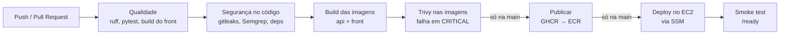

# EduRAG — Plano de implementação da pipeline (F2 → deploy na AWS)

> Atualizado em 19/10/2026. Referências: [spec.md](spec.md) e [progresso.md](progresso.md).
> Regra da Camada B: **você escreve os workflows**; a IA explica e revisa.

## Visão geral

A pipeline é construída em portões: cada etapa só é adicionada depois que a anterior está verde, e **nada chega à AWS sem passar por testes e scans**. O link público só existe depois da F3 (autenticação e rate limit), porque a API passa a gastar créditos reais.

| Bloco | Etapas | Resultado |
| --- | --- | --- |
| A — Integração contínua | 0 a 3 | Todo PR testado; `main` protegida |
| B — Segurança na pipeline | 4 a 7 | Segredos, código, dependências e imagens verificados |
| C — Publicação | 8 | Imagens versionadas num registro |
| D — Pronto para ser público | 9 | Autenticação, rate limit e LLM na nuvem |
| E — Entrega na AWS | 10 a 12 | Deploy automático e link no ar |

---

## Bloco A — Integração contínua

### Etapa 0 — Preparação

- [x] Registrar o frontend na spec: mover "Interface web" de *Fora de escopo* para os requisitos (RF09) e a tarefa (T11).
- [x] Confirmar que nenhum `.env` real está no repositório nem no histórico (`git log --all -- .env`).

*Pronto quando:* a spec descreve o que existe no código.

### Etapa 1 — CI do backend

- [x] Workflow disparado em `push` e `pull_request`.
- [x] Checkout → instalar `uv` (com cache) → `uv sync` → `ruff check` e `ruff format --check`.
- [x] `pytest` com um *service container* `pgvector/pgvector` e `TEST_DATABASE_URL` apontando para ele, rodando as migrations antes.
- [x] Relatório de cobertura como artefato do job.

*Pronto quando:* os 59 testes passam no GitHub, **0 pulados**.
*Para estudar:* sintaxe de workflow (`on`, `jobs`, `steps`), `services`, cache de dependências.

### Etapa 2 — CI do frontend

- [x] Job separado, rodando em paralelo ao do backend.
- [x] `npm ci` (nunca `npm install` na CI) → lint → build.
- [ ] Testes, se houver. (ainda não há testes no front)

*Pronto quando:* os dois jobs ficam verdes no mesmo PR.
*Para estudar:* jobs paralelos, `needs`, por que `npm ci` usa o lockfile.

### Etapa 3 — Proteção da branch `main`

- [x] Exigir PR para entrar na `main` (sem push direto).
- [x] Exigir os checks das etapas 1 e 2 como obrigatórios.

*Pronto quando:* um PR com teste quebrado não consegue ser mesclado.
**A partir daqui, toda mudança entra por PR**, inclusive as próximas etapas.

---

## Bloco B — Segurança na pipeline

Para cada ferramenta: primeiro rodar em modo de relatório, corrigir o que aparecer, **depois** transformar em portão que falha o build. E sempre provar o bloqueio com um PR proposital.

### Etapa 4 — Segredos (gitleaks)

- [x] Job do gitleaks em todo PR (`.github/workflows/security.yml`, job `gitleaks`, check obrigatório no ruleset `protege-main`).
- [x] Uma varredura única em **todo o histórico** do repositório (gitleaks v8.30.1 via Docker, `--log-opts="--all"`): nenhum achado.

*Teste de bloqueio:* PR com uma chave falsa no formato de chave da AWS → pipeline falha.
**Provado em 19/10/2026 (PR #6):** `gitleaks` falhou com `aws-access-token` e comentou na linha da chave; `backend` passou; merge bloqueado. O PR foi fechado sem merge. A chave de exemplo da AWS (`...EXAMPLE`) **não** serve para essa prova, porque a regra tem uma exceção para ela.
*Para estudar:* por que um segredo apagado num commit posterior continua vazado.

### Etapa 5 — Análise estática (SAST)

- [ ] Semgrep cobrindo Python e TypeScript (ou Bandit no backend + regras de segurança do ESLint no front).
- [ ] Resultados enviados para a aba *Security* do GitHub (formato SARIF).

*Teste de bloqueio:* PR com SQL montado por concatenação de string → apontado.
*Para estudar:* SAST × DAST, falso positivo e como suprimir com justificativa.

### Etapa 6 — Dependências

- [ ] `.github/dependabot.yml` para Python, npm, Docker e GitHub Actions (é arquivo de configuração, não job).
- [ ] `trivy fs` no repositório e `npm audit` no front, falhando em severidade alta ou crítica.
- [ ] Fixar as actions usadas por versão ou SHA.

*Teste de bloqueio:* PR adicionando uma versão antiga e vulnerável de alguma biblioteca → pipeline falha.
*Para estudar:* SCA, CVE, por que fixar as actions é segurança de cadeia de suprimentos.

### Etapa 7 — Build e scan das imagens

- [ ] Build das imagens `api` e `front` (Nginx servindo o build do React) com cache do Buildx.
- [ ] `trivy image` em cada uma, falhando em CRITICAL.
- [ ] Conferir que as duas rodam como usuário não-root.

*Pronto quando:* as imagens só existem se passaram no scan.
*Para estudar:* camadas de imagem, por que imagem base slim reduz vulnerabilidades.

---

## Bloco C — Publicação

### Etapa 8 — Publicar no GHCR

- [ ] Só na `main` e só depois de todos os portões anteriores.
- [ ] Login com o `GITHUB_TOKEN` (sem criar segredo novo).
- [ ] Tag com o SHA do commit (e `latest` só como apelido).

*Pronto quando:* cada merge na `main` gera uma imagem rastreável até o commit.
*Para estudar:* por que tag por SHA permite rollback e `latest` não.

---

## Bloco D — Pronto para ser público (F3 antecipada)

### Etapa 9 — Segurança da aplicação antes de expor

- [ ] Adaptador `ClaudeLLM` para a `LLMPort`, escolhido por `LLM_PROVIDER` (`ollama` local, `claude` na nuvem).
- [ ] Decidir os embeddings na nuvem: Ollama só com o `nomic-embed-text` (testar a memória) ou provedor externo (exige migration e reindexação).
- [ ] Autenticação no backend (login simples ou API key por usuário); nenhuma chave no código do React.
- [ ] Rate limiting por usuário/IP e tamanho máximo de upload mantido.
- [ ] CORS restrito ao domínio do front; cabeçalhos de segurança no Nginx.
- [ ] Limite de gastos configurado no Console da Anthropic.

*Pronto quando:* um visitante sem login não consegue gerar nenhuma chamada ao LLM.

---

## Bloco E — Entrega na AWS

### Etapa 10 — Base na AWS (feita uma vez, à mão e documentada)

- [ ] Alerta de orçamento (AWS Budgets) no primeiro dia.
- [ ] Usuário do dia a dia sem ser o root, com MFA.
- [ ] Provedor **OIDC** do GitHub e uma *role* IAM com permissão mínima (ECR e SSM), sem access key guardada.
- [ ] Repositórios no **ECR** para `api` e `front`.
- [ ] **EC2** com Docker, agente do **SSM** e *security group* abrindo só 80/443 (sem SSH aberto para a internet).
- [ ] Postgres no EC2 via compose, com volume persistente e backup simples.

*Para estudar:* IAM, princípio do menor privilégio, OIDC × access keys.

### Etapa 11 — Deploy contínuo

- [ ] Na `main`, depois da etapa 8: autenticar via OIDC e enviar as imagens ao ECR.
- [ ] Via SSM no EC2: `docker compose pull` + `up -d` com a tag do commit.
- [ ] Segredos de produção (chave do Claude, senha do Postgres) vindos do SSM Parameter Store ou Secrets Manager, nunca do repositório.
- [ ] Smoke test chamando `/ready`; se falhar, voltar para a tag anterior.

*Pronto quando:* um merge na `main` aparece no ar sozinho, e um deploy quebrado volta sozinho.

### Etapa 12 — Domínio e HTTPS (opcional)

- [ ] Domínio apontando para o EC2 (você já tem `rafaelmenezes.dev.br`; um subdomínio serve).
- [ ] HTTPS com Let's Encrypt (Caddy ou Certbot no Nginx), ou CloudFront na frente.

---

## Depois da pipeline

- **F4 — Observabilidade:** métricas, painel de latência do LLM e alerta perto do `LLM_TIMEOUT_SECONDS`.
- **F5 — LLMOps:** Langfuse, Ragas na CI (vira mais um portão da pipeline), defesa contra prompt injection e experimento de `CHUNK_SIZE`.
- **F6 — Kubernetes.**

## Comprovação para o currículo

Guarde, a cada etapa, o print ou o link do PR que provou o portão: o PR com segredo falso barrado, o PR com dependência vulnerável barrado, o deploy automático e o rollback. Junto com o README, isso vira a evidência de "DevSecOps na prática".
